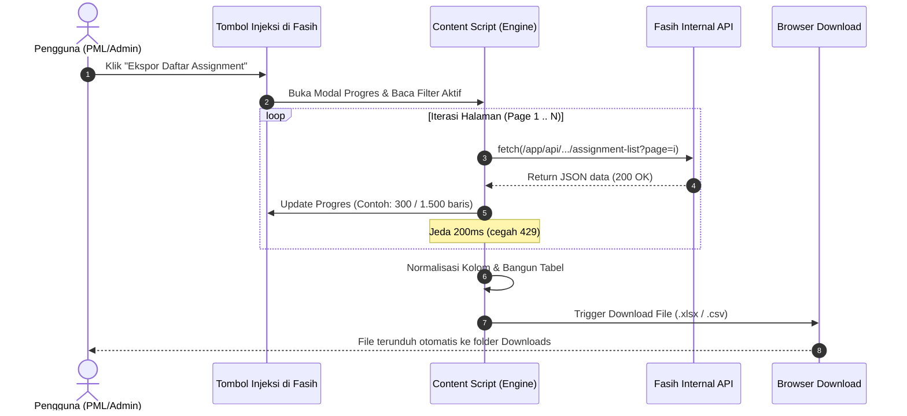
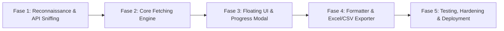

# PRD & Implementation Playbook: Fasih Assignment Scraper (Chrome Extension)

Dokumen ini merinci **Product Requirement Document (PRD)** dan **Playbook Eksekusi 5 Fase** untuk membangun ekstensi Google Chrome (Manifest V3) yang berfungsi mengekstrak (scraping) daftar penugasan (_assignments_) dan _raw data_ ringkas dari platform survei **Fasih SM (BPS)** secara otomatis dan aman ke format Excel/CSV.

---

## BAGIAN I: Product Requirement Document (PRD)

### 1. Latar Belakang & Masalah

- **Konteks:** Sistem Fasih SM BPS adalah aplikasi web modern berbasis _Single Page Application_ (SPA) dengan autentikasi SSO BPS (Keycloak). Semua data penugasan dikirim melalui API internal berformat JSON.
- **Permasalahan Pengguna:**
  1. Pengawas/PML/Admin saat ini harus memeriksa daftar assignment halaman demi halaman di antarmuka web, tanpa fitur bawaan yang cepat untuk mengunduh seluruh mentahan data (_raw data_) per wilayah/petugas.
  2. Ekspor manual atau pengecekan satu per satu memakan waktu berjam-jam saat beban survei mencapai ratusan hingga ribuan entri.
  3. Membangun script Python murni terkendala alur autentikasi SSO yang dinamis dan risiko terblokir/kedaluwarsa sesi.
- **Solusi Produk:** Ekstensi Chrome ringan berbasis **Manifest V3** yang berjalan di peramban pengguna, memanfaatkan sesi login SSO yang sudah aktif, menarik data penugasan langsung dari endpoint internal Fasih secara _paginated_, dan mengekspornya dalam bentuk Excel/CSV dengan 1 klik.

---

### 2. Sasaran Produk (Goals & Non-Goals)

#### Goals

1. **One-Click Raw Data Pull:** Pengguna dapat mengekstrak seluruh daftar assignment sesuai filter yang aktif (provinsi/kabupaten/kecamatan/desa/petugas) hanya dengan menekan satu tombol di halaman Fasih.
2. **Zero-Login Overhead:** Tidak membutuhkan konfigurasi kredensial, API key, atau setup Python; ekstensi otomatis mewarisi _session cookies_ pengguna.
3. **Format Siap Olah:** Menghasilkan file `.xlsx` atau `.csv` dengan kode wilayah rapi (preservasi _leading zeros_ seperti `001`, `010`) dan kolom status terstandarisasi.
4. **Resilient Rate-Limiting:** Mampu mendeteksi limitasi request Fasih (HTTP 429) dan melakukan _smart throttle_ (jeda otomatis) agar proses scraping tidak terputus.

#### Non-Goals

1. **Tidak Melakukan Modifikasi Data:** Ekstensi ini murni _read-only_ (scraping/penarikan data), tidak mengubah, mengisi, atau mengirim form (berbeda dengan ekstensi _inject_).
2. **Tidak Membutuhkan Server Eksternal:** Seluruh proses berjalan 100% di browser pengguna (_client-side only_). Tidak ada data survei yang dikirim ke server pihak ketiga.

---

### 3. Kebutuhan Fungsional (Functional Requirements)

| ID       | Fitur                           | Deskripsi                                                                                                                        | Prioritas        |
| -------- | ------------------------------- | -------------------------------------------------------------------------------------------------------------------------------- | ---------------- |
| **FR-1** | **UI Button & Modal Inject**    | Menyisipkan tombol ekspor ("📥 Ekspor Daftar Assignment") di atas tabel daftar penugasan Fasih SM.                               | P0 (Must Have)   |
| **FR-2** | **Filter & Context Awareness**  | Mendeteksi ID Periode aktif, filter wilayah, dan status yang sedang dipilih pengguna di halaman Fasih.                           | P0 (Must Have)   |
| **FR-3** | **Automated Pagination Engine** | Melakukan perulangan pengambilan data API per halaman (_page-by-page_) hingga seluruh data terkumpul.                            | P0 (Must Have)   |
| **FR-4** | **Rate-Limiting & Backoff**     | Menambahkan jeda adaptif (misal 150–300 ms per page) dan otomatis jeda 30–60 detik jika mendeteksi HTTP 429.                     | P0 (Must Have)   |
| **FR-5** | **Progress Bar & Control**      | Menampilkan modal popup progres: jumlah baris terambil, estimasi waktu, serta tombol jeda (_pause_) / batal (_cancel_).          | P1 (Should Have) |
| **FR-6** | **Client-Side Exporter**        | Mengonversi array JSON menjadi file `.xlsx` (menggunakan pustaka ringan) dan `.csv` (UTF-8 dengan BOM untuk Excel).              | P0 (Must Have)   |
| **FR-7** | **Kolom Raw Data Lengkap**      | Mengekstrak minimal: Assignment ID, Kode Wilker (Kec/Desa/SLS), Nama Usaha/KRT, Status Dokumen, PCL, PML, Waktu Terakhir Update. | P0 (Must Have)   |

---

### 4. Kebutuhan Non-Fungsional (Non-Functional Requirements)

- **Keamanan & Privasi:** Tidak menyimpan data survei secara persisten dan tidak menggunakan server perantara. Sesuai standar tata kelola data statistik.
- **Performa Memori:** Mampu menampung hingga 10.000 entri JSON di memori browser tanpa menyebabkan tab mengalami crash (_Out of Memory_).
- **Kompatibilitas:** Berjalan lancar di Google Chrome / Microsoft Edge versi 110+ dengan arsitektur Manifest V3.

---

### 5. Arsitektur Teknis Ekstensi



---

## BAGIAN II: Implementation Playbook (5 Fase)

Playbook ini dirancang bertahap agar pembangunan ekstensi terstruktur, minim bug, dan aman terhadap perubahan sistem Fasih SM.



---

### Fase 1: Reconnaissance & Endpoint Sniffing (Observasi)

> **Tujuan:** Mengetahui secara pasti URL endpoint, parameter query, header, dan skema JSON yang dikembalikan oleh daftar assignment Fasih SM.

- **Langkah Kerja:**
  1. Buka halaman daftar penugasan di Fasih SM via browser Chrome.
  2. Buka **DevTools** (`F12`) → masuk ke tab **Network** → filter `Fetch/XHR`.
  3. Lakukan interaksi (ganti halaman / ubah filter status).
  4. Amati request yang dipanggil:
     - Catat URL endpoint (contoh umum: `/app/api/assignment-general/api/assignment/...` atau `/app/api/assignment/list`).
     - Catat query parameters: `page`, `limit` / `pageSize`, `periodeId`, `status`, `kecamatan`, `sort`.
     - Catat struktur respons JSON: letak array data (misal `res.data.content` atau `res.data.assignments`) dan total data/total halaman (`res.data.totalElements`, `res.data.totalPages`).
- **Deliverable Fase 1:** Catatan spesifikasi API (URL, query param, dan JSON sample).

---

### Fase 2: Core Fetching Engine (Logika Scraping & Resiliensi)

> **Tujuan:** Membangun modul JavaScript yang bertugas mengonsumsi API Fasih secara _paginated_ dengan proteksi _rate-limiting_.

- **Langkah Kerja:**
  1. Buat fungsi `fetchPage(pageIndex, filterParams)` menggunakan API `fetch` bawaan dengan opsi `{ credentials: 'include' }`.
  2. Bangun alur perulangan (`while` loop atau `for` loop):
     - Ambil halaman pertama untuk membaca `total_halaman`.
     - Lakukan iterasi dari halaman 1 hingga selesai.
  3. Pasang **Adaptive Throttle**:
     - Berikan jeda `sleep(200)` setiap antar-request.
     - Tambahkan blok `try-catch` khusus HTTP 429: bila terdeteksi status 429, jeda eksekusi selama 30 detik sebelum mencoba kembali (_exponential retry_).
  4. Bangun parser pemipih (_flattening JSON_):
     - Membongkar struktur objek bersarang (nested JSON) menjadi objek datar 1 dimensi per baris.
- **Deliverable Fase 2:** Script fungsi `scraperEngine.js` yang dapat diuji coba langsung di Console DevTools untuk menarik 2–3 halaman data.

---

### Fase 3: Floating UI & Progress Modal (Integrasi Tampilan)

> **Tujuan:** Menghadirkan antarmuka pengguna yang elegan dan menyatu dengan halaman web Fasih.

- **Langkah Kerja:**
  1. Di `content.js`, pasang _observer_ (`MutationObserver`) untuk mendeteksi kapan tabel penugasan Fasih selesai dirender.
  2. Sisipkan tombol aksi **"📥 Ekspor Data (Raw)"** di bilah alat (_toolbar_) tabel Fasih atau sebagai _floating button_ di sudut kanan bawah.
  3. Buat modal dialog progres sederhana:
     - Teks status: _"Mengambil halaman 5 dari 20 (100 / 400 data)..."_
     - _Progress bar_ visual (0%–100%).
     - Tombol **"Jeda"** dan **"Batal"** agar pengguna tetap memiliki kontrol penuh.
- **Deliverable Fase 3:** Tampilan UI tombol dan dialog modal progres yang interaktif pada halaman Fasih SM.

---

### Fase 4: Formatter & Excel/CSV Exporter (Output File)

> **Tujuan:** Memastikan data yang terkumpul dapat diunduh dalam format tabular yang bersih dan langsung siap digunakan tanpa masalah format.

- **Langkah Kerja:**
  1. **Preservasi Format String:**
     - Pastikan kolom kode wilayah (Kecamatan, Desa, SLS) dan NIK/ID tidak terpotong atau kehilangan angka nol di depan (_leading zero_).
  2. **Ekspor CSV:**
     - Tambahkan byte order mark UTF-8 (`\uFEFF`) di awal file agar teks khusus dan aksen terbaca sempurna di Microsoft Excel.
     - Bungkus setiap nilai sel dengan tanda kutip ganda (`"..."`).
  3. **Ekspor Excel (.xlsx):**
     - Integrasikan pustaka ringan seperti `xlsx.mini.min.js` (SheetJS mini) atau generator XML spreadsheet sederhana agar bisa menghasilkan file `.xlsx` asli.
  4. Beri penamaan file otomatis yang rapi:
     - Contoh: `Raw_Assignment_Fasih_<Periode>_<YYYYMMDD_HHmm>.xlsx`.
- **Deliverable Fase 4:** Fungsi `exportToFile(data, format, filename)` yang langsung memicu dialog download peramban.

---

### Fase 5: Testing, Hardening & Deployment (Pengujian & Pengemasan)

> **Tujuan:** Menguji ekstensi pada berbagai skenario riil dan mengemasnya agar siap dipasang oleh tim.

- **Langkah Kerja:**
  1. **Manifest Configuration:**
     - Susun `manifest.json` (MV3) yang ringkas:
     ```json
     {
       "manifest_version": 3,
       "name": "Fasih Assignment Raw Exporter",
       "version": "1.0.0",
       "content_scripts": [
         {
           "matches": ["https://fasih-sm.bps.go.id/app/*"],
           "js": ["vendor/xlsx.mini.min.js", "exporter.js", "content.js"]
         }
       ]
     }
     ```
     > [!TIP]
     > Untuk scraping via `content.js` pada origin yang sama (`https://fasih-sm.bps.go.id`), Anda bahkan **tidak memerlukan** background service worker atau permission `debugger`. Ini membuat ekstensi sangat ringan dan bebas dari pop-up _"Chrome is being debugged"_.
  2. **Pengujian Beban (Stress Testing):**
     - Uji penarikan data pada volume kecil (50 baris), menengah (500 baris), dan besar (2.000+ baris).
     - Uji skenario saat koneksi internet lambat atau terjadi _rate limit_ 429.
  3. **Pembuatan Panduan Instalasi (README):**
     - Tulis panduan ringkas cara _Load unpacked_ ekstensi via menu `chrome://extensions`.
- **Deliverable Fase 5:** Folder ekstensi siap pakai dan panduan instalasi pengguna.

---

## Ringkasan Matriks Keputusan Pengembangan

```
+-------------------------------------------------------------+
|                     EKSTENSI CHROME                         |
|  - Auth SSO: Otomatis (via Cookie aktif di browser)         |
|  - Akses: Langsung di web Fasih via tombol 1-Klik           |
|  - Output: File .xlsx/.csv langsung masuk folder Downloads  |
|  - Maintenance: Ringan (cukup perbarui jika API berubah)   |
+-------------------------------------------------------------+
```
